## Ordering PCB For Production

First download the files located in [pcb_production_files](../pcb_production_files).

Navigate to the JLCPCB ordering page [here](https://jlcpcb.com?from=JoseanMartinez).
Then click on "Get Instant Quote".

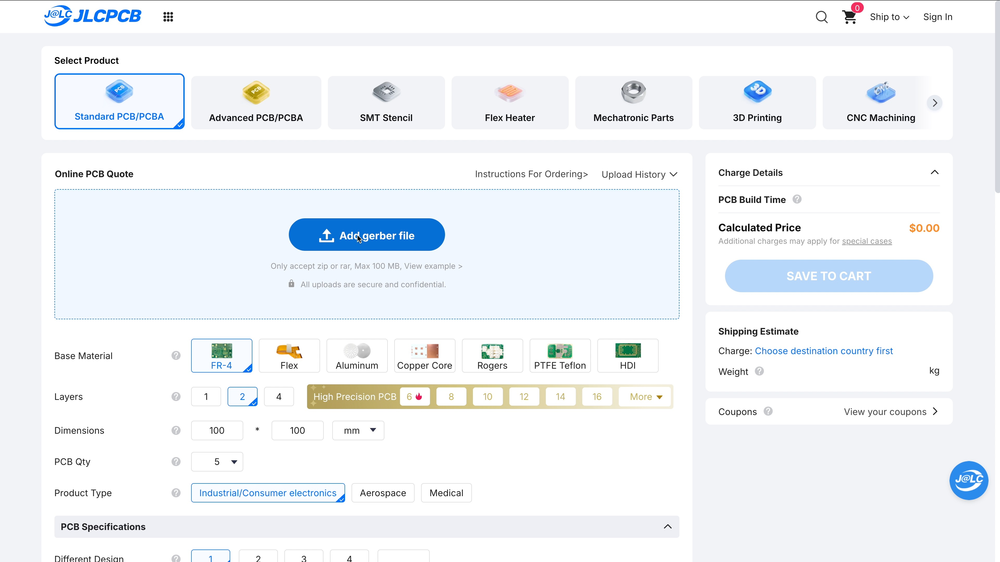

Now you can click on "Add Gerber File" and then upload the `Macropad.zip` file.

Next choose how many PCBs you'd like to order, a color for it, and I also like choosing **LeadFree HASL** for the
Surface Finish.

### PCB Assembly

I highly recommend you use the Assembly service for the **Diodes, Capacitor and Logic Level Shifter**.

To use this option, turn it on. Use **Economic** instead of Standard for a more affordable price.

Then select Bottom Side and choose how many PCBs to include in the assembly.

Then click on **Next**.

In **Bill of Materials**, upload `bom.csv` for "BOM" and `positions.csv` for "CPL".

Now you'll see that the LEDs are not selected as they require "Standard" PCBA and it'll be more expensive.

You can decide if you want to solder these yourself or not. If you don't want to, when prompted (about 3 times), click on "Do not place".

You might be asked a total of three times before you can continue.

Now you can finalize your order. In "Product Description", I select "Researc/Education/DIY/Entertainment" -> "DIY Hobby Circuit Board".

## Soldering

### Solder the Hotswap Sockets

Solder each socket in this orientation:

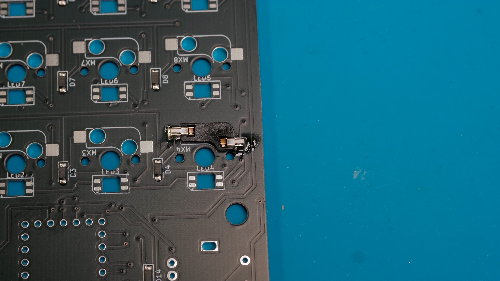

I like adding solder to one pad first, then melting it and placing the socket with tweezers into place. I do this
for all of them and then solder the other pad for each socket.

### Solder the LEDs

If not assembled at the factory, solder them like so:

Again, I like to solder one pad first, secure the led into place with tweezers and then solder the rest.
Use flux here. Dragging your iron with a little bit of solder makes this easier.

### Solder the Microcontroller

First solder the header pins for the microcontroller. Use tap to secure each piece into place before soldering.

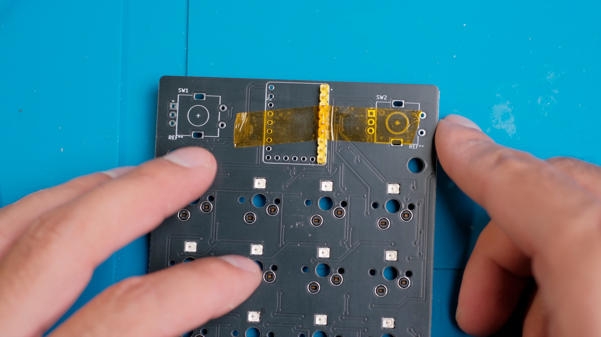

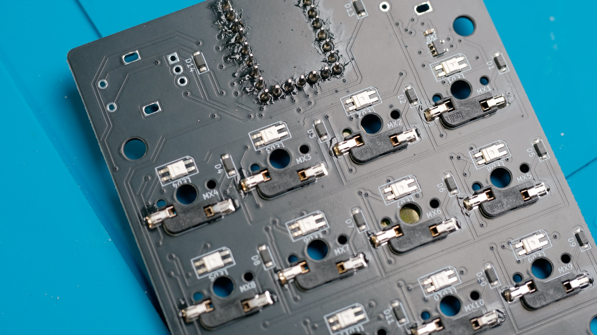

Final result:

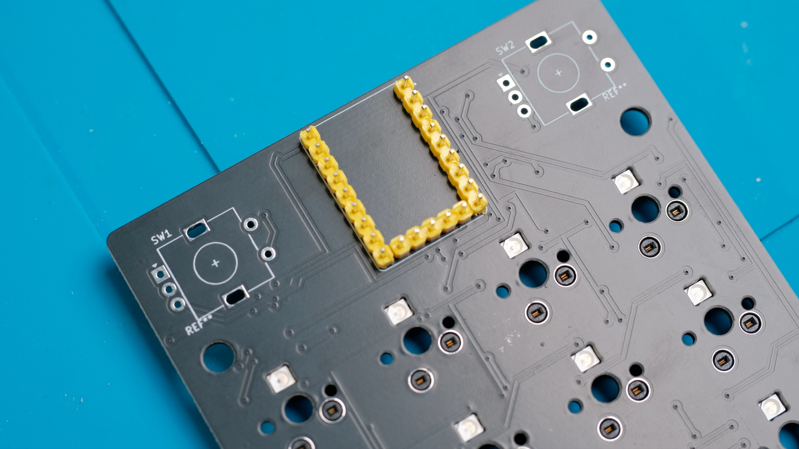

Now place the microcontroller with the buttons facing up to solder it into place.

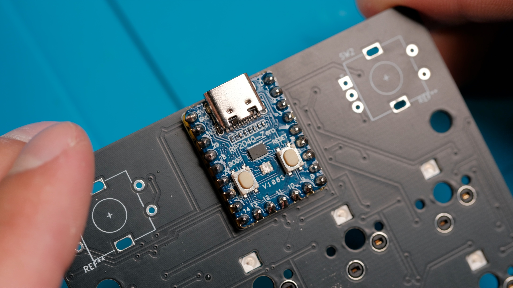

### Solder Rotary Encoders

Tape the rotary encoder into place first before soldering.

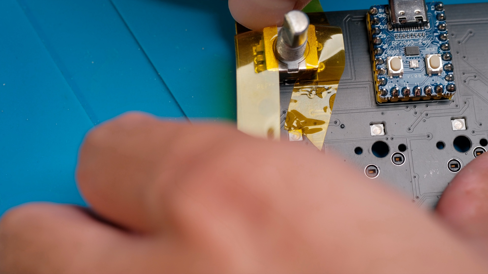
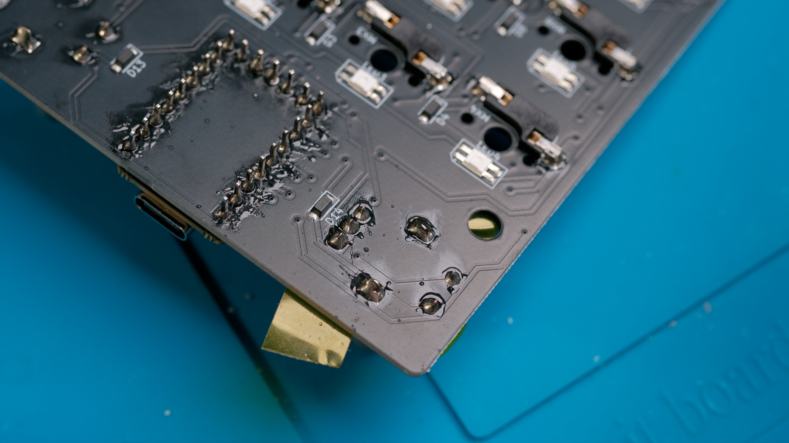
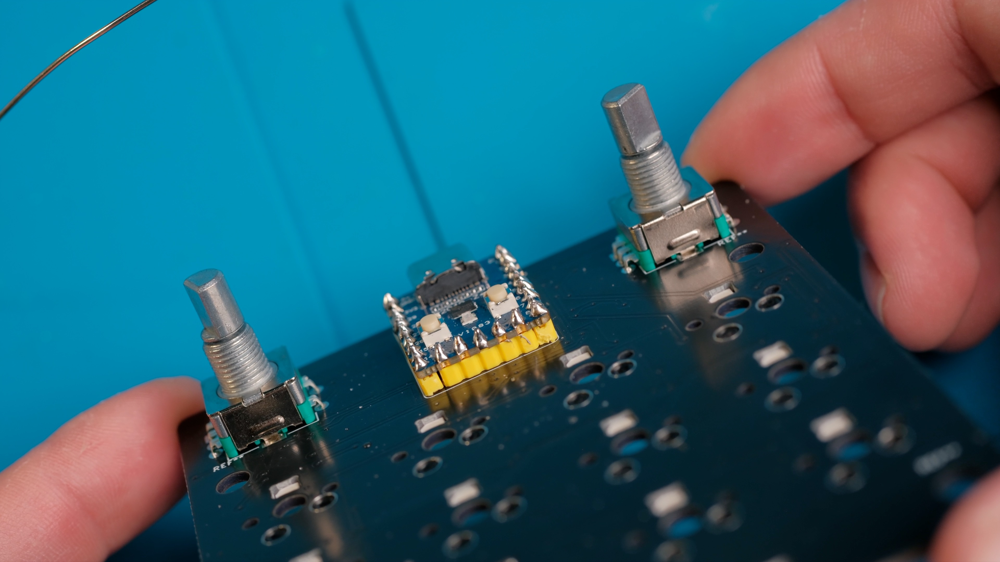

## Flashing

Connect microcontroller to computer while holding down the "BOOT" button.

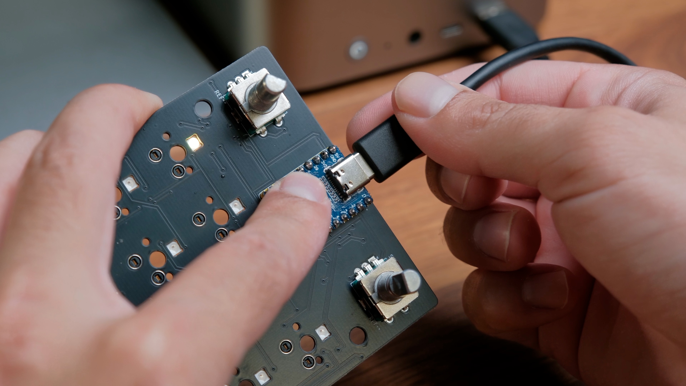

Mount the microcontroller with your file explorer.

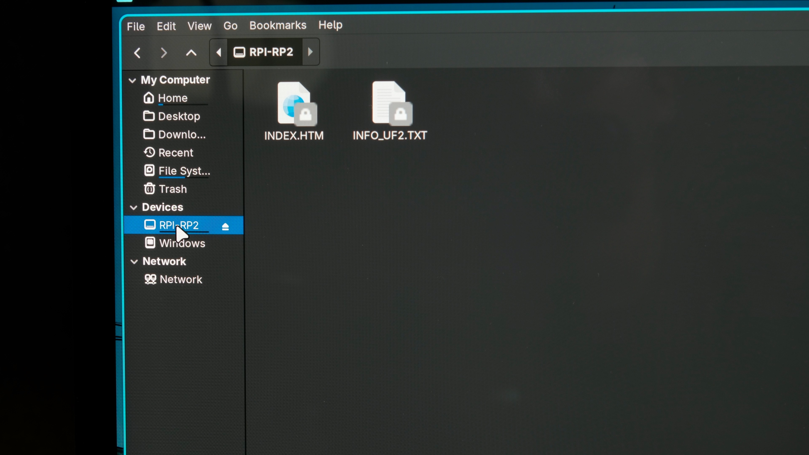

Drag the firmware file to the mounted rp2040 zero.

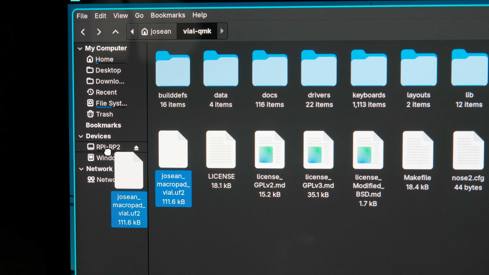

You can navigate to [vial.rocks](https://vial.rocks) to modify the keymaps and macros on the default firmware.

## Case printing and Assembly

Add m2 screws to the bottom of the case.
